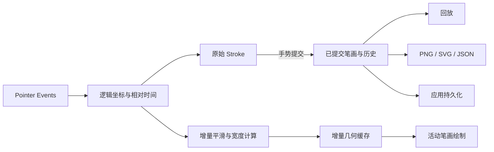

# 架构与职责

## 仓库结构

| 目录 | 职责 |
| --- | --- |
| packages/core | 原生 TypeScript SDK，Canvas 2D、输入、历史、回放、几何与导出 |
| apps/web | React 画板、参数实验、外观与 IndexedDB 作品存储 |
| examples/vanilla | 独立 JS 接入示例，从实际 tarball 生成运行资产 |
| scripts | 体积报告、真实包消费与示例准备 |
| docs | 开发计划、验收记录、API、数据格式及性能原始报告 |

当前构建使用 tsc 生成 SDK ESM/声明文件，Vite 构建 Web；工作区由 pnpm 管理。SDK 不依赖 React，也没有运行时第三方依赖。

## 输入与文档

`engine.ts` 管理一个 Canvas 实例。输入使用 Pointer Events 和可用的合并事件，映射到固定逻辑尺寸；取消输入不会提交历史。笔刷起笔时快照，后续设置只影响下一笔。

文档保存原始点，`stroke.ts` 提供逐点状态转换，批处理与实时输入使用相同算法。`geometry.ts` 将处理后点转换为圆形和连接多边形；`render.ts` 消费几何并提交 Canvas 路径。SVG 使用相同几何来源，JSON 保留原始点。

## 渲染缓存与限制

- 已提交笔画复用独立画布，仅在文档、擦除集合或分辨率变化时失效。
- 活动笔画每点处理一次，缓存最多 100,000 个几何顶点；超限释放几何缓存并流式回退。
- 默认效果下的不透明笔画以 64 段批次绘制；活动完整批次累积到独立栅格前缀，末尾不足批次仍实时提交。
- 栅格前缀最多 4,000,000 物理像素；尺寸变化重建，手势结束/取消释放。透明或特殊效果保持整笔路径，不进入该优化。
- 橡皮先排除包围盒，再进行精确扫掠命中；手势内几何缓存限制 32 笔/100,000 顶点。

这些预算只限制对应缓存，不限制整页内存、历史或浏览器内部路径存储。透明长笔画仍存在栅格开销。近期优化的浏览器像素和性能验收尚未完成，详见[性能报告](PERFORMANCE.md)。

## 历史、回放与导出

历史使用文档笔画数组的快照；引擎拥有内部对象，对外读写进行复制或校验，调用方不应依赖内部共享。新提交清空 redo，回放不改变文档。当前历史没有容量预算。

回放按每笔相对时间生成前缀，不保存真实笔间停顿。导出读取完整已提交文档，与屏幕回放进度无关。PNG 通过独立 Canvas 编码；SVG 使用矢量填充路径；JSON 经公开版本格式往返。

## 应用与 SDK 的边界

应用负责作品元数据、IndexedDB、缩略图、主题、快捷键、缩放平移和错误提示；SDK 负责绘制语义与导出。主题/纸色不属于核心 JSON；PNG 底色由导出参数控制。

本地作品写入按作品身份排队，切换前处理保存结果。当前没有云端、登录、多标签冲突合并或协作协议。生命周期结束必须调用 `destroy()`，由实例解除事件监听、观察器和活动缓存。

## 发布验证

`check:package` 将 tarball 安装到工作区之外，验证 ESM、公开 exports、依赖和 TypeScript 消费。`example:build` 额外准备安装包资产并构建原生示例。它们不执行发布，也不替代浏览器、真实触控设备或跨浏览器验收。
